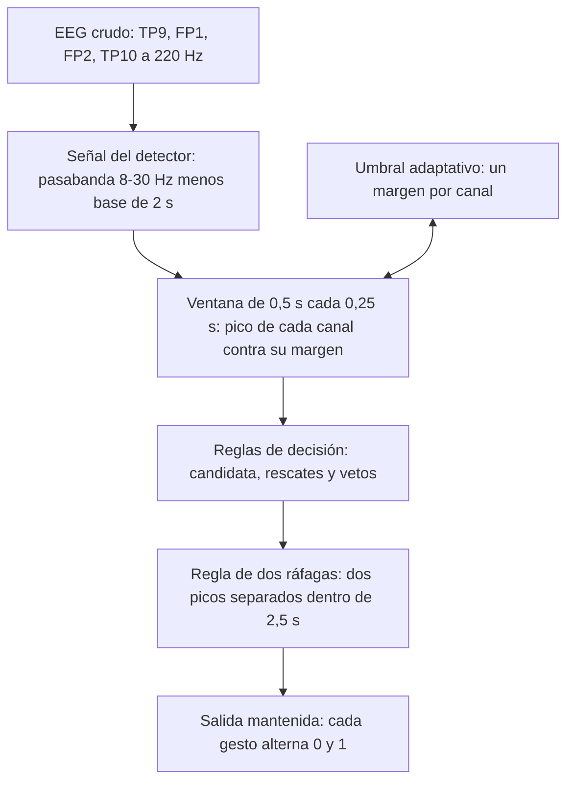
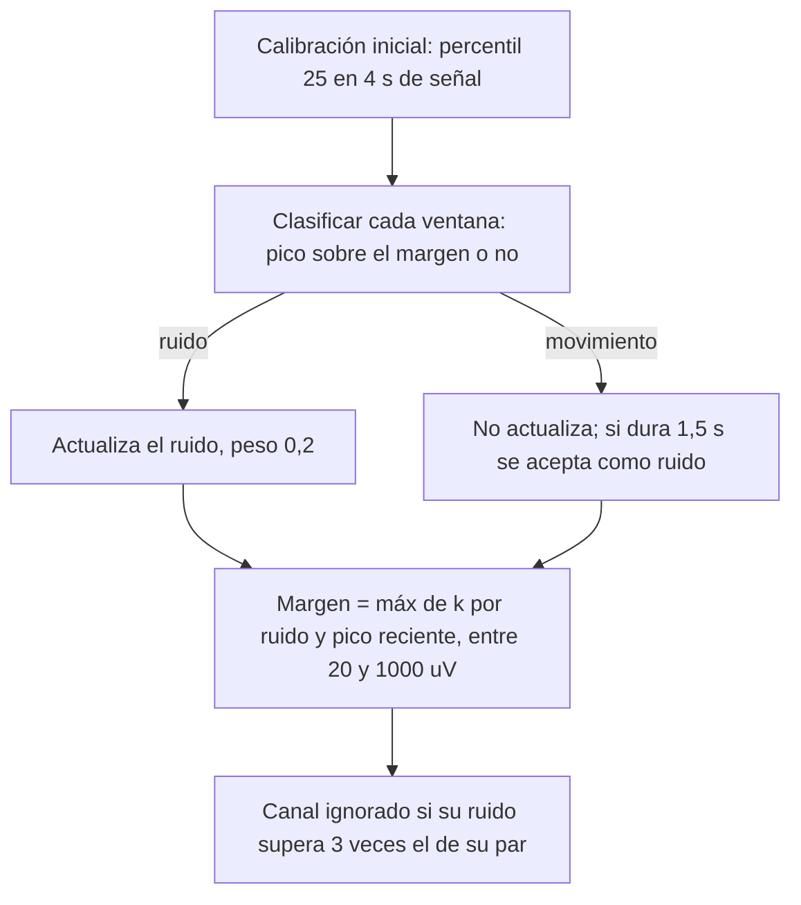

# Diagrama de flujo del filtro (MotorGestos, gestos_tiempo_real.py / pi/detector_gestos.py)

Una pasada completa por cada ventana: ventana de 0,5 s, una decisión cada 0,25 s.

## 1. Recorrido general

## 2. Reglas de decisión, en el orden en que se aplican

| # | Regla | Tipo | Qué exige o hace |
|---|---|---|---|
| 1 | Amplitud | habilita | un frontal (FP1/FP2) Y un temporal (TP9/TP10) sobre su margen |
| 2 | Pares | veto | ambos frontales y ambos temporales deben responder (con excepciones si un grupo es muy fuerte) |
| 3 | Coincidencia | veto | frontal y temporal sobre el margen a la vez, ±0,1 s |
| 4 | Solo frontales | rescate | ambos frontales 4,5 veces sobre su margen, aunque ningún temporal responda |
| 5 | Lógica difusa | veto | relación entre canales (correlaciones TP9-TP10, FP1-FP2, frontal-temporal) por debajo de 0,4 |
| 6 | Temporales inútiles | rescate | si algún margen temporal supera 300 µV, deciden solo los frontales |
| 7 | Incremento parcial | rescate | frontales activos y un temporal que sube sin llegar a su margen |
| 8 | Crecimiento temporal | rescate | un temporal supera 1,3 veces su pico de ruido reciente |
| 9 | Saturación | veto | 3 o más canales tocan el límite del sensor (contacto perdido) |
| 10 | Evidencias paralelas | rescate | frontal activo y 6 de 7 evidencias sobre su umbral |
| 11 | Dos ráfagas | veto | dos picos separados (0,12 s sin superar) dentro de 2,5 s |
| 12 | Rebote | veto | detección más débil que 0,6 veces la anterior, a menos de 1 s: es su cola |

Los rescates solo se evalúan si la ventana todavía no es candidata; los vetos apagan una ventana ya candidata.

## 3. Umbral adaptativo de cada canal

k vale 6 para los frontales y 8 para los temporales.

## 4. Salida

- Un gesto nuevo es una ventana con detección a más de 1,25 s de la anterior.
- La activación (la que va a la Pico) alterna: 0 pasa a 1 con un gesto y 1 pasa a 0 con el siguiente.
- `pulso` es la retención corta de 1 s después de cada detección, solo para mirar.
